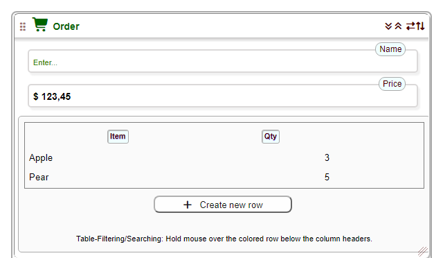

# php2html – Clever HTML Engine

[](https://github.com/EV-soft/Clever-Html-Engine/releases)
[](https://www.php.net/)
[](LICENSE)

**Write your web pages in PHP – not in HTML.** php2html is one PHP file with 78 functions that turn short, readable calls
into complete, valid HTML5: input fields with labels, hints and validation, sortable tables, collapsible cards, menus,
dialogs and whole pages – with translation, light/dark themes and CSRF protection built in. No build step, no template
language, no JavaScript framework.

## In 30 seconds

```php
<?php
$needFontawesome= '2';                                          // Icons from the CDN
$GLOBALS['gbl_ProgRoot']= 'vendor/ev-soft/clever-html-engine/'; // Where the library is - seen from the page
require 'vendor/ev-soft/clever-html-engine/php2html.lib.php';

htm_Page_(titl:'@Hello');
    htm_Card_(capt:'@Order', icon:'fa-solid fa-cart-shopping');
        htm_Input(labl:'@Name',  vrnt:'text', name:'name', valu:'');
        htm_Input(labl:'@Price', vrnt:'dec2', name:'price', valu:123.45, unit:'<$ ');
        $rows= [['Apple', 3], ['Pear', 5]];
        htm_Table(body:[['@Item', '60%', 'text', '', ['left'],  'item'],
                        ['@Qty',  '40%', 'text', '', ['right'], 'qty']], data:$rows, vhgh:'auto');
    htm_Card_end();
htm_Page_end();
```



Every text that starts with `@` is translated (Danish, German, French and Swedish are included). The card can be
folded, resized and moved by the user, the price field accepts only a number with 2 decimals, and the page follows
the light or dark theme of the browser.

## Why php2html?
- **Compact, readable code** – one call per element, named arguments with a fixed set of 4-character names (`labl`, `hint`, `vrnt`, `valu` ...).
- **Front end and back end in one file** – no templates to keep in sync.
- **Complete fields** – label, hint, placeholder, validation, unit and number format in one call.
- **Advanced tables** – sort, filter, row actions, CSV export (Mottie Tablesorter) – or simple search and sort without jQuery.
- **Cards and a view bar** – collapsible, resizable, movable cards; zoom, full screen, column view, language, notes, page help and theme.
- **Multilingual** – every `@text` goes through the translation engine; the user picks the language with a flag.
- **Secure by default** – escaped output, a CSRF token in every form, a session warning before the session ends.
- **Accessible and printable** – keyboard use, ARIA names, skip links; printing shows only the content.
- **No build step** – external libraries (Font Awesome, Tablesorter, TinyMCE, pdf.js) come from a CDN or a local folder, only when asked for.

## Install

**With Composer**
```bash
composer require ev-soft/clever-html-engine
```
Then `require 'vendor/ev-soft/clever-html-engine/php2html.lib.php';` in your page, and set `$GLOBALS['gbl_ProgRoot']` to the
path of that folder seen from the page (as in the example above). The browser loads the library's CSS/JS from that folder,
so it must be reachable on the web, and the web server must be able to write its `_cache/` folder.

**Without Composer**
```bash
git clone https://github.com/EV-soft/Clever-Html-Engine.git
```
or download a [release](https://github.com/EV-soft/Clever-Html-Engine/releases) and copy the folder to your web server.
Requires PHP 8.1 or newer (named arguments).

## Built with php2html
- **[Folder-explorer](https://github.com/EV-soft/folder-explorer)** – a file manager in one PHP file: folder sizes in a tree,
  file preview (images, PDF, Office, Excel, e-books ...), upload, a transfer basket, ZIP, accounts and rights.
  [Live demo](https://ev-soft.dk/foldexpl/folder-explorer.php) – a good real-world example of `htm_Table()`, cards and menus.
- **The demo and documentation** in `Proj.demo/` – every function with live examples, e.g. the
  [customer order](https://ev-soft.work/p2h/v1.7.x/Proj.demo/CustomerOrder.page.php) page.

Have you built something with php2html? Open an issue or a pull request, and it will be listed here.

## Documentation
- Online demo and documentation: [ev-soft.work/p2h/v1.7.x](https://ev-soft.work/p2h/v1.7.x/Proj.demo/PHP2HTML-intro.page.php) (use the top menu)
- Project page: [ev-soft.github.io/Clever-Html-Engine](https://ev-soft.github.io/Clever-Html-Engine/)
- What is new in each version: [CHANGELOG.md](CHANGELOG.md)
- Step by step: `Quick_Proj/quickstart.page.php` and the `*.page.php` files in `Proj.demo/`

## Contributing
Ideas, bug reports and pull requests are welcome – open an [issue](https://github.com/EV-soft/Clever-Html-Engine/issues).

## License
GPL-3.0 – see [LICENSE](LICENSE). © 2019-2026 EV-soft.

## Upgrading to 1.7
- **Named arguments** (`labl:'@Name', vrnt:'text'`) work as before - nothing to do. They are the recommended way to call the library.
- **Positional arguments** (`htm_Input('@Name', '@Enter...', ...)`) must be checked: their meaning follows the position. Run the upgrade tool on your code **before** you replace the library:
  ```bash
  php tools/named_args.php  my_project/            # shows what would be changed
  php tools/named_args.php  my_project/  --write    # changes the files (a copy is saved as *.bak)
  ```
  It knows the old and the new order of the 34 functions and rewrites a call to named arguments from the first position whose name has changed - the result works with both 1.6 and 1.7. An old-style argument `$labl= '...'` becomes `labl: '...'`. Code examples inside strings are not changed - check them yourself.
  Code written for **1.6.3 or older**: add `--from=1.6.3` (in those versions `htm_CodeBox()` had `rtrn` as argument 6 - `fold` since 1.6.4).
  Do not run the tool on code written for 1.7 - it would read the positions as the old ones.
- The old alias names (`vlue`, `widt`, `heig`, `hght`) still work.
- **1.7.2:** `htm_TextArea()`, `htm_ActionButt()`, `htm_MultistateButt()` and `htm_ModalDialog()` echo by default - the tool adds `rtrn: true` where their result is used.

***

## More about php2html
Your tool to quickly program html code in your PHP web project.

php2html.lib.php also called "HTML clever engine" consists of a PHP library, with 78 core functions that generate HTML code for standard html elements (INPUT / CHECKBOX / RADIO-GROUP / TABLE), as well as other useful functions.
You get a complete system to form the frontend part of your program.
Built into the system is the easy use of several open-source modules (icons, advanced tables, HTML editor, jquery), and a complete system for changing user languages.	

Standards: PHP 8.1+ (named arguments), HTML5, CSS3, JavaScript.

Source should be in UTF-8, with no tabs, indent: 4 chars

When using <i>PHP2HTML</i> your code will be more compact, and easier to read, and you can have both backend and frontend code in one file.

<i>As an example this high level PHP code:</i>

```php
htm_Input(vrnt:'dec2', name:'dec2', valu:$dec2, labl:'@htm_Input(Dec2)',
          hint:'@Demo of htm_Input Field type dec2: number with 2 decimal',
          algn:'center', unit:'<$ ');
```

<i>will generate this HTML code</i> (with `$dec2= 54321`, lines broken for reading):

```html
<div class="inpField" id="inpBox1" style="margin: auto; padding: 0 2px 6px; width: 100%; display: inline-block; vertical-align: top;">
  <input type="text" id="id_dec2" name="dec2" value="$ 54 321,00" class="boxStyle"
         style="text-align: center; font-size: 14px; font-weight: 600;"
         oninvalid="this.setCustomValidity('Wrong or missing data in htm_Input(Dec2) ! ')" oninput="setCustomValidity('')"
         placeholder="Enter..." pattern="^[^0-9\-]{0,4}\s?-?\d[\d\s.,]*\s?[^0-9]{0,4}$" />
  <abbr class="hint">
    <label for="id_dec2" style="font-size: 12px; vertical-align:top;">
      <div style="white-space: nowrap; margin-left: auto;">htm_Input(Dec2)</div>
    </label>
    <data-hint style="top: 45px; left: 2px;">Demo of htm_Input Field type dec2: number with 2 decimal <br>Unit: $ </data-hint>
  </abbr>
</div>
```

and looks like this:


<h3><b>Integrated benefits of the system:</b></h3>
<ul>
<li>Advanced translation system - choose the language with flags in the view bar</li>
<li>Block-oriented provides compact code</li>
<li>Possibility of Font-awesome Icons anywhere</li>
<li>Hints/Tooltip for all html elements</li>
<li>Placeholder/validation for all input elements</li>
<li>Compact layout with advanced collapsible cards - the user can resize and move them, and show them in columns</li>
<li>Floating view bar: zoom, full screen, column view, language, personal notes, page help and theme</li>
<li>Light, dark, automatic and own color themes</li>
<li>Option for user defined system blocks - customize a project without editing the library ($gbl_InitFile, $gbl_CustomCss ...)</li>
<li>Advanced tables based on Mottie Table Sorter system - or simple search and sort without jQuery (htm_TableTools)</li>
<li>TinyMCE integrated HTML-editor library</li>
<li>PDF viewer (pdf.js)</li>
<li>Optional use of libraries locally or on the Web (CDN)</li>
<li>Narrow cards suitable for automatic adaptation, and print of the content only</li>
<li>Easily enter dates with browsers date picker interface</li>
<li>Security built in: escaped output, CSRF token in every form, session warning before the session ends</li>
</ul>


<br><strong>About the powerful external libraries:</strong> (all optional - jQuery is only needed by Tablesorter and jQuery UI)<br>
jquery&nbsp; &nbsp; &nbsp; &nbsp; &nbsp; &nbsp; &nbsp; &nbsp; &nbsp; "jquery" &nbsp; &nbsp; &nbsp; &nbsp; &nbsp; &nbsp; &nbsp; &nbsp; &nbsp; &nbsp; &nbsp; &nbsp; &nbsp; &nbsp; <a title="More about the system..." href="https://jquery.com/" target="_blank" rel="noopener">Feature-rich JavaScript library</a><br>
jquery-ui&nbsp; &nbsp; &nbsp; &nbsp; &nbsp; &nbsp; &nbsp; "jquery-UserInterface"&nbsp; &nbsp; &nbsp; <a title="More about the system..." href="https://jqueryui.com/" target="_blank" rel="noopener">User interface interactions</a><br>
tablesorter&nbsp; &nbsp; &nbsp; &nbsp; &nbsp; &nbsp;"Advanced tables"&nbsp; &nbsp; &nbsp; &nbsp; &nbsp; &nbsp; <a title="More about the system..." href="https://mottie.github.io/tablesorter/docs/" target="_blank" rel="noopener">Plugin for turning a standard HTML table into a sortable table</a><br>
font-awesome&nbsp; &nbsp; &nbsp;"Icons"&nbsp; &nbsp; &nbsp; &nbsp; &nbsp; &nbsp; &nbsp; &nbsp; &nbsp; &nbsp; &nbsp; &nbsp; &nbsp; &nbsp; &nbsp; <a title="More about the system..." href="https://fontawesome.com/" target="_blank" rel="noopener">Icon library and toolkit</a><br>
tinymce&nbsp; &nbsp; &nbsp; &nbsp; &nbsp; &nbsp; &nbsp; &nbsp; "HTML rich text editor"&nbsp; &nbsp; <a title="More about the system..." href="https://www.tiny.cloud/" target="_blank" rel="noopener">Self hosted advanced WYSIWYG HTML editor</a><br>
dialog-polyfill&nbsp; &nbsp; &nbsp; &nbsp;"popup dialog"&nbsp; &nbsp; &nbsp; &nbsp; &nbsp; &nbsp; &nbsp; &nbsp; <a title="More about the system..." href="https://github.com/GoogleChrome/dialog-polyfill" target="_blank" rel="noopener">Dialog element for a popup box</a><br>
pdf.js&nbsp; &nbsp; &nbsp; &nbsp; &nbsp; &nbsp; &nbsp; &nbsp; &nbsp; &nbsp;"PDF viewer"&nbsp; &nbsp; &nbsp; &nbsp; &nbsp; &nbsp; &nbsp; &nbsp; &nbsp; &nbsp; <a title="More about the system..." href="https://mozilla.github.io/pdf.js/" target="_blank" rel="noopener">Show PDF files in the page</a><br><br>


<h3><b>How to start your first project</b></h3>

Save system-files on your web-server in system-folder '{public-URL}/hello'

Create project-folder '/world' and create the file: '{public-URL}/hello/world/first.page.php' with this content (it is also in the repository):

```php
<?php
#   Getting started:
#   How to output your first page...

$sys= $GLOBALS["gbl_ProgRoot"]= '../';     // a system variable: path to the system folder

## Activate needed libraries: Set 0:deactive  1:Local-source  2:WEB-source-CDN  3:Auto: Local/CDN
$needJquery=      '0';
$needTablesorter= '0';
$needPolyfill=    '0';
$needFontawesome= '2';
$needTinymce=     '0';

require_once ($sys.'php2html.lib.php');    // the system library

### PAGE-START:
htm_Page_(titl:'@DEMO', hint:'', info:lang('@PHP2HTML: My first page'), inis:'',
          algn:'center', imag:'../_accessories/_background.png', pbrd:false);

    htm_Caption(labl:'@HELLO WORLD:', icon:'fa-solid fa-earth-europe', hint:'@This is your first page', algn:'center',
                styl:'color:#550000; font-weight:600; font-size: 18px;');

    htm_Card_(capt:'@My first card', icon:'fa-solid fa-star', clas:'cardW480');
        htm_Input(labl:'@Your name', plho:'@Enter...', hint:'@Type your name', vrnt:'text', name:'yourName', valu:'');
        htm_Input(labl:'@Price', hint:'@Enter amount with 2 decimals', vrnt:'dec2', name:'price', valu:123.45, unit:'<$ ');
    htm_Card_end();

### :PAGE_END
htm_Page_end();
```

Now you can see the page in your browser at URL: '{public-URL}/hello/world/first.page.php'

Another more in-depth way is to follow the instructions in Quick_Proj/quickstart.page.php

Advanced example - see files in folder: '{public-URL}/hello/Proj.demo/'
 
<h3><b>More information...</b></h3>

You can see a combined documentation & demo and try the functions here: https://ev-soft.github.io/Clever-Html-Engine/

To learn the system and its possibilities, it is recommended to study the *.page.php files in the folder: Proj.demo

<h3><b>Online-Demo:</b></h3>

Get inspired and test the system.

Go to the full window demo and see advanced example: [CustomerOrder](https://ev-soft.work/p2h/v1.7.x/Proj.demo/CustomerOrder.page.php)

Use the top menu to view documentation and examples.

<p style="text-align: center;"><b>

                      PHP is the language to make server-side backend programming.

            PHP2HTML is your tool/framework to make your client-side frontend programming in PHP.
     		
               "HTML clever engine" combines frontend and backend php in a common PHP file.

</b></p>
